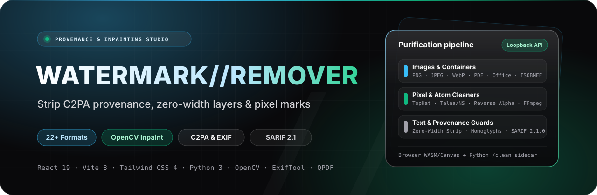
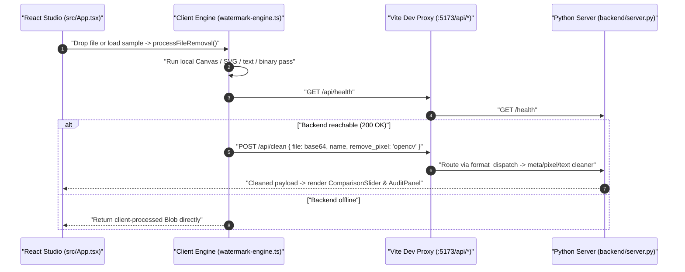

<p align="center">
  
</p>

<p align="center">
  
</p>

<p align="center">
  <a href="https://react.dev"></a>
  <a href="https://vite.dev"></a>
  <a href="https://tailwindcss.com"></a>
  <a href="https://www.typescriptlang.org"></a>
  <a href="https://oxc.rs"></a>
  <a href="https://www.python.org"></a>
</p>

**Universal Watermark Remover** is a multi-modal provenance stripping, invisible-watermark sanitization, and image boundary-inpainting workbench spanning a React 19 / Vite 8 web studio and a local Python 3 `ThreadingHTTPServer` backend. It inspects and cleans 22+ image, document, markup, audio, and video formats across client browser APIs and byte-level Python cleaners, plus SARIF 2.1.0 directory/website auditing and Git pre-commit hooks.

---

## Contents

- [Features and supported formats](#features-and-supported-formats)
- [Dual-plane architecture](#dual-plane-architecture)
- [Backend API and CLI suite](#backend-api-and-cli-suite)
- [Getting started](#getting-started)
- [Optional ML harnesses](#optional-ml-harnesses)
- [Environment variables](#environment-variables)
- [Scripts](#scripts)
- [Security and known limitations](#security-and-known-limitations)

---

## Features and supported formats

| Domain | Client studio (`src/lib/watermark-engine.ts`) | Python backend (`backend/`) |
| :--- | :--- | :--- |
| **Raster images** (`.png`, `.jpg`, `.jpeg`, `.webp`, `.avif`, `.heic`, `.bmp`, `.gif`, `.tiff`) | 7×7 TopHat/BlackHat segmentation, 2-pass distance transform, Telea-style inpainting & Reverse Alpha Blending on `<canvas>` | Byte-level PNG/JPEG/WebP/AVIF/HEIC/TIFF/GIF/BMP provenance & C2PA stripping (`image_meta.py`), `exiftool`, `c2patool`, OpenCV edge-protected TopHat/Telea/NS inpainting, optional CtrlRegen / MarkDiffusion |
| **Vector & text** (`.svg`, `.html`, `.htm`, `.md`, `.markdown`, source code) | XML `<metadata>`/`<rdf:RDF>`/watermark element stripping (`DOMParser`), zero-width character & frontmatter cleaning | `container_meta.py`, deterministic Layer A invisible codepoints (`text_unicode.py`), homoglyph folding (`clean_text.py`), Layer B LLM rewrite (`rewrite_text.py`), stylometry & Gumbel scoring |
| **Document containers** (`.pdf`, `.docx`, `.xlsx`, `.pptx`, `.epub`, `.odt`) | Naive ASCII `c2pa` -> `free` byte-buffer patch fallback | `container_meta.py`: Office XML/Zip property & embedded asset cleaning, ExifTool + QPDF + bounded Ghostscript deep image cleaning + recursive PDF attachments |
| **Audio & video** (`.mp4`, `.mov`, `.m4v`, `.m4a`, `.wav`, `.mp3`, `.flac`) | Naive ASCII `c2pa` -> `free` byte-buffer patch fallback | `av_meta.py` (ISOBMFF/ID3v2/RIFF/Vorbis tag stripping), optional FFmpeg audio transform (`clean_audio.py`), frame-by-frame video transform (`clean_video.py`) |
| **Auditing & Git hooks** | Visual `ComparisonSlider` & `AuditPanel` with sample generators (`samples.ts`) | `audit_dir.py` & `audit_website.py` (SARIF 2.1.0), `check_staged.py`, `clean_staged.py`, `hook_written_file.py` |

---

## Dual-plane architecture

The Vite dev server proxies `/api/*` requests to `http://127.0.0.1:8000` (rewriting the `/api` prefix away in `vite.config.ts`), allowing the browser studio to upgrade processing with the Python backend when running locally:



> [!NOTE]
> Three runtime integration details apply to the current frontend-to-backend bridge:
> 1. **Port alignment**: `vite.config.ts` proxies `/api` to `http://127.0.0.1:8000`, whereas `backend/server.py` defaults to `127.0.0.1:8765`. Launch `backend/server.py` with `--port 8000` (or `WATERMARKS_SERVER_PORT=8000`) when using the Vite UI.
> 2. **Double pass on raster images**: `processFileRemoval()` runs `<canvas>` inpainting locally *before* calling `POST /api/clean`, sending the already Canvas-re-encoded Blob to Python when connected.
> 3. **UI audit telemetry**: `watermark-engine.ts` constructs hardcoded report indicators (`stillHasC2pa: false`, `synthidBefore: 0.86` -> `synthidAfter: 0.02`) rather than reading the server's `still_has_c2pa` / `synthid_*` response fields.

---

## Backend API and CLI suite

`backend/server.py` runs purely on the Python 3 standard library (`ThreadingHTTPServer`) and inspects optional external binaries (`exiftool`, `qpdf`, `gs`, `ffmpeg`, `c2patool`) and ML sidecars at runtime:

| Endpoint | Method | Purpose |
| :--- | :--- | :--- |
| `/health` | `GET` | Liveness check (`{ ok: true, version }`) |
| `/capabilities` | `GET` | Reports installed CLI binaries, pixel removers, text detectors, and sidecar status |
| `/openapi.json` | `GET` | Live OpenAPI 3.0.3 schema generated from `ALLOWED_CLEAN_OPTIONS` |
| `/inspect`, `/inspect/batch` | `POST` | Classifies magic bytes/extension (`format_dispatch.py`) and reports C2PA, Unicode Layer A, watermark, and stylometry flags |
| `/detect`, `/detect/batch` | `POST` | Runs configured text detectors (`markllm`, `gumbel`) or image SynthID scoring sidecar |
| `/clean`, `/clean/batch` | `POST` | Executes metadata/container stripping, OpenCV/GPU pixel removal (`remove_pixel`), and text Layer A cleaning (`remove_audio_watermark`, `deep_images`, `clean_attachments`) |
| `/watermark`, `/watermark/batch` | `POST` | Generates SynthID watermarked text via `WATERMARKS_SYNTHID_TEXT_URL` or `MARKLLM_DIR` (`503` if unconfigured) |

Key CLI tools in `backend/`: `audit_dir.py` / `audit_website.py` (SARIF 2.1.0 scanners), `synthid_score_server.py` (port `8766`), `synthid_text_server.py` (port `8767`), `check_staged.py`, and `clean_staged.py`.

---

## Getting started

### Prerequisites

- Node.js 20+ and npm (frontend studio)
- Python 3.10+ (backend server and CLIs)
- Optional Python packages for OpenCV inpainting: `pip install opencv-python numpy`
- Optional OS binaries on `PATH` for full container fidelity: `exiftool`, `qpdf`, `gs` / `gswin64c`, `ffmpeg`, `ffprobe`, `c2patool`

### Run the full stack locally

Terminal 1 — Python backend (matching Vite's `:8000` proxy target):

```bash
cd backend
python server.py --host 127.0.0.1 --port 8000
```

Terminal 2 — React / Vite frontend (`http://localhost:5173`):

```bash
npm install
npm run dev
```

---

## Optional ML harnesses

GPU/research models are intentionally kept out of git and installed into isolated virtual environments via helper scripts inside `backend/`:

| Script | Upstream project & pinned commit | Purpose |
| :--- | :--- | :--- |
| `setup_ctrlregen.sh` / `.ps1` | `mertizci/noai-watermark` (`b642ae45`) | Diffusion-based CtrlRegen watermark removal (`NOAI_WATERMARK_DIR`) |
| `setup_markdiffusion.sh` | `THU-BPM/MarkDiffusion` (`cefdb320`) | Image diffusion purification (`MARKDIFFUSION_DIR`) |
| `setup_markllm.sh` | `THU-BPM/MarkLLM` (`c45ddc40`) | Text watermark detection & generation (`MARKLLM_DIR`) |
| `setup_synthid.sh` / `.ps1` | `aloshdenny/reverse-SynthID` (`b1108367`) | Spectral SynthID image scoring (`REVERSE_SYNTHID_DIR`) |

---

## Environment variables

| Variable | Scope | Default / local value | Notes |
| :--- | :--- | :--- | :--- |
| `WATERMARKS_SERVER_PORT` | `backend/server.py` | `8765` (`--port 8000` for Vite) | Listening port for HTTP server |
| `WATERMARKS_SERVER_HOST` | `backend/server.py` | `127.0.0.1` | Loopback bind address |
| `WATERMARKS_SERVER_API_KEY` | `backend/server.py` | Unset (optional Bearer auth) | Note: `watermark-engine.ts` sends no `Authorization` header |
| `WATERMARKS_MAX_INPUT_BYTES` | `backend/server.py` | `268435456` (256 MiB) | Single-file byte limit (`MAX_BATCH_FILES = 50`) |
| `WATERMARKS_REWRITE_BACKEND` | `backend/rewrite_text.py` | `print-prompt` | Supports `print-prompt`, `ollama`, `openai-compatible` |
| `WATERMARKS_REWRITE_ALLOW_REMOTE` | `backend/rewrite_text.py` | Unset (loopback-only) | Must opt in (`1`) for non-loopback LLM URLs |
| `NOAI_WATERMARK_DIR`, `MARKDIFFUSION_DIR`, `MARKLLM_DIR`, `REVERSE_SYNTHID_DIR` | External harnesses | Unset | Paths to externally cloned optional ML checkouts |
| `WATERMARKS_GUMBEL_KEY` | `backend/detect_gumbel.py` | Unset | Secret key for model-free Gumbel-Max replay scoring |

---

## Scripts

| Command | Description |
| :--- | :--- |
| `npm run dev` | Starts Vite 8 studio on `http://localhost:5173` with `/api` proxy -> `:8000` |
| `npm run build` | Typechecks (`tsc -b`) and builds static production assets to `dist/` |
| `npm run lint` | Runs `oxlint` using `.oxlintrc.json` |
| `npm run preview` | Serves compiled `dist/` locally |

Backend verification helpers (require manual invocation from `backend/`):
- `python test_formats.py` — Exercises `server._clean_payload` across synthetic minimal files.
- `python test_svg_clean.py` — Integration check requiring a running server on `127.0.0.1:8000`.

---

## Security and known limitations

- **Server-side resource & SSRF hardening**: `backend/server.py` binds loopback by default, caps single uploads at `256 MiB` and HTTP bodies at `384 MiB`, checks `tmpdir` traversal and `S_ISREG` regular files, applies `RLIMIT_AS`/`RLIMIT_FSIZE` on child ML processes, and pins resolved public IPs with redirect blocking in `audit_website.py` and `rewrite_text.py`.
- **No CORS headers or auth UI in frontend**: `backend/server.py` sends no CORS headers and the browser engine sends no Bearer token when `WATERMARKS_SERVER_API_KEY` is set; dev traffic relies on Vite's `/api` proxy.
- **Standalone pricing & status UI**: `PricingSection` buttons have no Stripe/checkout handlers, and `Navbar` accepts `backendConnected` props without displaying server connection status.
- **Unused starter & duplicate artifacts**: Vite template remnants (`public/favicon.svg`, `public/icons.svg`, `src/App.css`, legacy dark `src/components/header.tsx`) remain alongside active light-mode studio components, and `vite.config.ts` aliases `@/components/ui` to the root `components/ui/` directory rather than `src/components/ui/`.

---

<p align="center">
  <sub>Universal Watermark Remover · React 19 · Vite 8 · Python 3 · Provenance &amp; Inpainting Workbench</sub>
</p>
